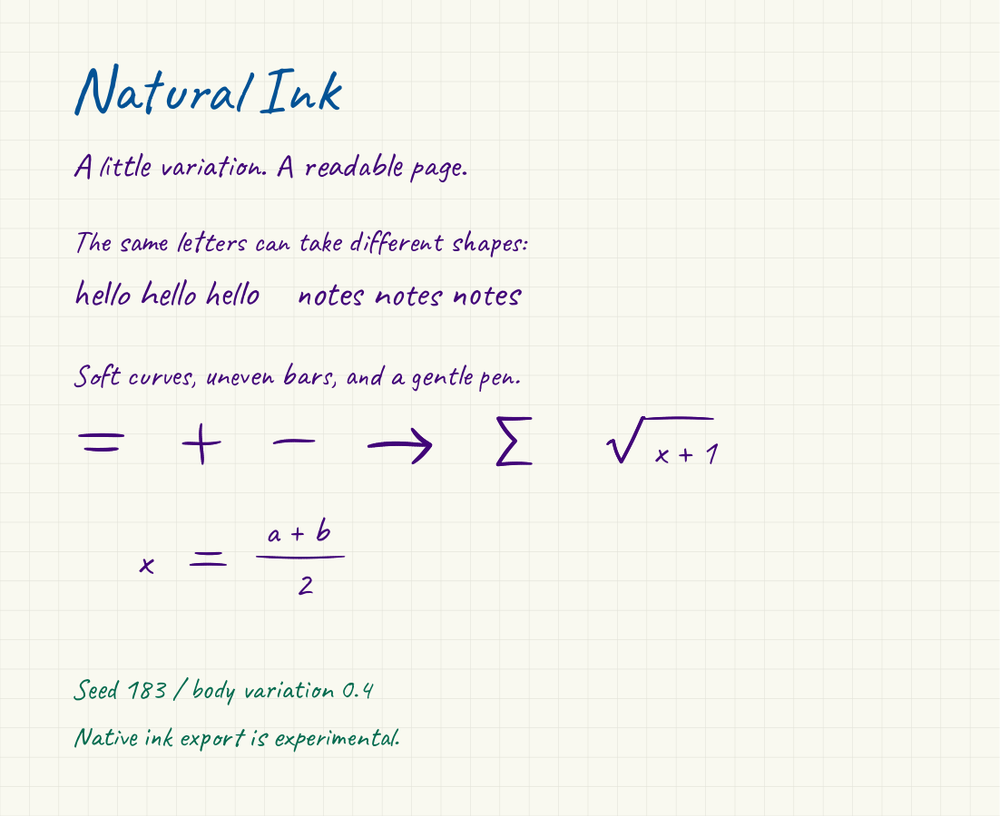

# Natural Ink

Readable handwriting-style documents with varied letterforms, curved mathematical strokes, and reproducible randomness.

[中文说明](README.zh-CN.md) · [Format notes](docs/goodnotes-format.md) · [Attribution](NOTICE.md)



Natural Ink started with a simple observation: a handwriting font still looks printed when every letter repeats and every equation uses perfectly straight bars. It combines real glyph alternates, gentle contour changes, local spacing variation, and hand-drawn mathematical gestures. Body variation and math styling are separate, so making prose easier to read does not turn equals signs back into rulers.

## What works

| Capability | Status |
| --- | --- |
| Positioned text and math → vector PDF | Working; fonts embedded |
| Repeatable seeds and adjustable body variation | Working; same-environment PDF determinism tested |
| 48 mathematical gesture templates | Included |
| Colored PDF → portable ink JSON | Experimental approximation |
| Ink JSON → PDF / SVG preview | Working |
| Ink JSON → native `.goodnotes` archive | Experimental; independently decoded |
| Import, erase, lasso-move, and save/reopen in Goodnotes | User-tested on a dense, two-page private document |
| Partial-stroke erase, recolor, and cross-version compatibility | Acceptance checks pending |

**The native exporter writes stroke records, not a PDF renamed to `.goodnotes`.** The project owner imported a generated dense, two-page document into Goodnotes, erased ink, moved it with the lasso, and reopened it after saving with the edits still available. The app version and platform were not recorded; broader compatibility remains experimental. The original PDF remains the visual reference.

## Quick start

Requires Python 3.12+ and [uv](https://docs.astral.sh/uv/).

```sh
git clone https://github.com/LambertAlpha/natural-ink.git
cd natural-ink
uv sync --locked
uv run natural-ink render examples/demo.json -o output/demo.pdf
```

The input is a small JSON layout: page dimensions, positioned text, symbols, and rules. Coordinates and sizes are in PDF points (72 points = one inch), with the origin at the **top left**. Text `y` is the baseline; symbols `x,y` anchor their nominal box.

```json
{
  "pages": [{
    "items": [
      {"type": "text", "text": "hello hello", "x": 40, "y": 70, "size": 22},
      {"type": "symbol", "symbol": "=", "x": 40, "y": 100, "width": 24, "height": 9},
      {"type": "rule", "x": 90, "y": 105, "length": 55, "width": 1.2}
    ]
  }]
}
```

Adjust the prose without changing the mathematical gesture style:

```sh
uv run natural-ink render examples/demo.json -o output/quiet.pdf --seed 183 --variation 0.2
uv run natural-ink render examples/demo.json -o output/loose.pdf --seed 42 --variation 0.7
```

`--variation` is in `[0,1]`; default `0.4`. At zero, glyph alternates remain but outline/position distortion is disabled. Seeds are local SHA-256-derived random streams; they do not alter global random state. Text is positioned explicitly, not automatically wrapped. Missing glyphs and detected line overflow raise errors.

## Try native ink export

```sh
# Reconstruct approximate ink centerlines from a PDF.
uv run natural-ink trace output/demo.pdf -o output/demo.ink.json --scale 4

# Inspect the reconstruction before exporting.
uv run natural-ink preview output/demo.ink.json -o output/reconstructed.pdf
uv run natural-ink preview output/demo.ink.json -o output/page-1.svg --page 1

# Explicit opt-in: compatibility across app versions remains experimental.
uv run natural-ink export output/demo.ink.json -o output/demo.goodnotes --experimental
```

Import the `.goodnotes` file in Goodnotes. Check page count and appearance, erase part of a stroke, then move it with the lasso. Save, close, and reopen. Please report your app version, platform, and which step succeeds or fails; omit private notebook content. Editability here means manipulating ink strokes, not editing the source text or formula as semantic objects.

### Limits worth understanding

- **Tracing cannot recover original pen history.** Branches in a letter may become several independent strokes. Native stroke counts can be large; app performance is unmeasured.
- Tracing is designed for dark/color ink on a light background. It discards light gray grids and maps ink to a specified palette. It is **not a general photo, dark-mode, highlight, or arbitrary-PDF converter**.
- Default colors: purple, blue, green, black. Override with `--palette '#42067a,#035296,#046b4f,#000000'`.
- The current native adapter uses the observed schema-24 ballpoint form: **median width per path**. Ink JSON retains per-point widths; the native file does not preserve all pressure variation.
- Tracing loses PDF text/search semantics and page backgrounds; the native output uses plain ivory paper. Keep the original source JSON/PDF.
- There is no automatic LaTeX formula layout or general-purpose PDF restyling. Formula placement is explicit. Caveat's supported alphabet is checked at render time.
- The document-specific predecessor scripts are not required by this package. No course notes, personal references, or hardcoded local user paths are included.

## Development

```sh
uv sync --locked
uv run ruff check src tests scripts
uv run ruff format --check src tests scripts
uv run mypy src scripts
uv run pytest -q
uv build
```

CI also generates a neutral demo, traces it, exports native ink, and verifies every reconstructed path against an independent parser at a pinned revision. See [validation notes](docs/validation.md) for the exact boundary of this evidence.

```text
JSON layout ── fonts + math gestures ── vector PDF
                                          │
                                 approximate tracing
                                          ↓
                                  portable ink JSON
                                  ↙       ↓        ↘
                                PDF      SVG    .goodnotes
                                                experimental
```

The portable model makes new adapters possible without coupling the renderer to one note app. Contributions improving native compatibility, preserving pressure, and generating centerlines directly are welcome.

Code is MIT. Caveat is SIL OFL 1.1. Runtime dependencies have separate terms; see [NOTICE.md](NOTICE.md), including PyMuPDF's AGPL/commercial licensing.
